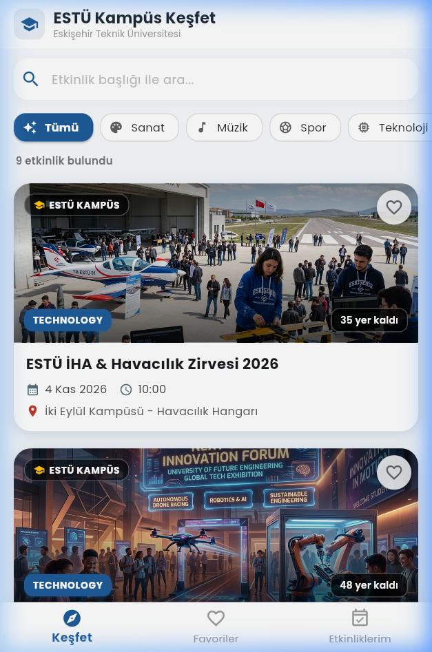
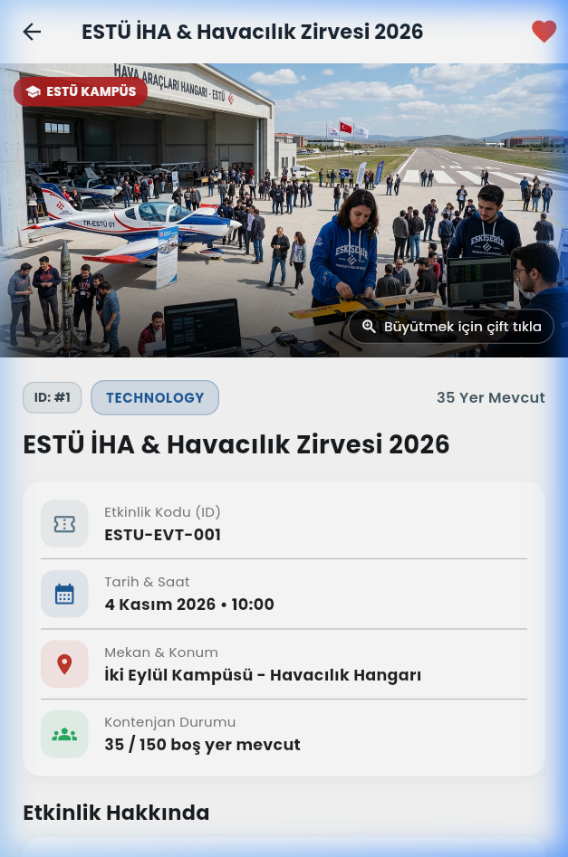
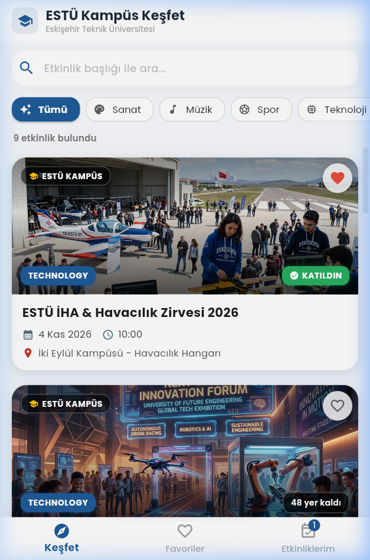
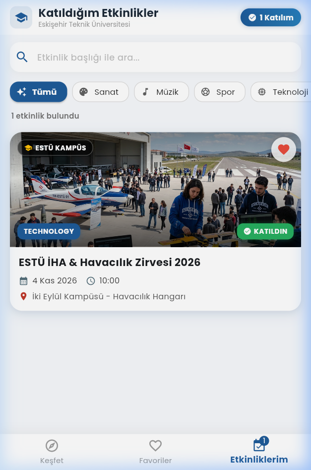
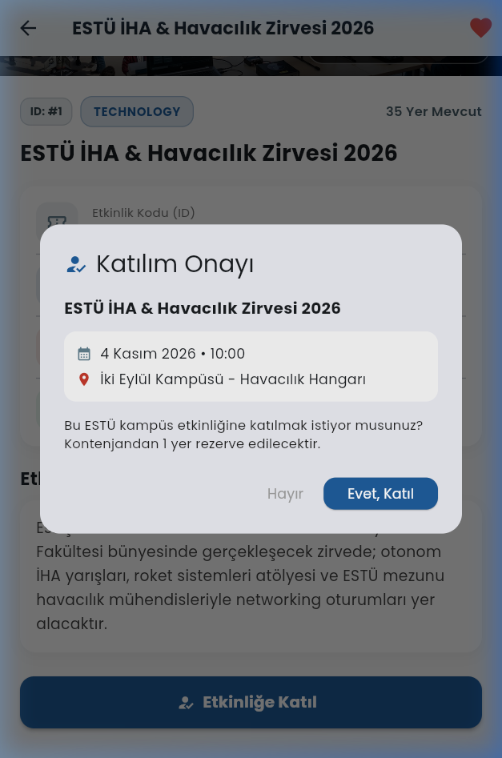
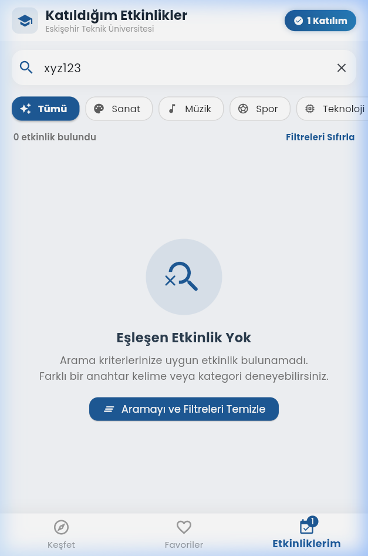

# ESTÜ Campus Event Explorer

Eskişehir Teknik Üniversitesi (ESTÜ) öğrencileri için geliştirilmiş; kampüs etkinliklerini keşfetme, filtreleme, favorilere ekleme ve katılım kontenjanını yönetme özelliklerine sahip Flutter mobil uygulaması.

> **BIM493 - Mobile Programming I | Assignment #1**  
> **Teslim Tarihi:** 25 Ekim 2026, 23:59 (UTC+3)

---

## 👥 Grup Bilgileri

| Adı Soyadı | Öğrenci No |
|---|---|
| Ömer Faruk ARSLAN | 22970712684 |

## 🤝 Katkı Paylaşımı (Member Contributions)

- **Ömer Faruk ARSLAN:** Etkinlik veri modeli (`event_model.dart`), başlangıç verileri (`event_data.dart`), ana sayfa ve arama/kategori filtreleme mekanizması (`home_screen.dart`), `EventCard` bileşeni ve UI tasarımı. Etkinlik detay ekranı (`event_detail_screen.dart`), katılım & iptal onay diyalogları ve mantığı, `ImageViewerScreen` (çift tıklama ve büyütme), widget testleri ve dökümantasyon.

---

## 🚀 Kurulum ve Çalıştırma (Setup & Run Commands)

### Gereksinimler
- Flutter SDK (`stable` kanal)
- Chrome / Edge tarayıcısı veya Android Emülatörü / Fiziksel Cihaz

### Bağımlılıkları Yükleme
```bash
flutter pub get
```

### Projeyi Çalıştırma

#### 1. Web'de (Chrome) Çalıştırma (Hızlı ve Önerilen):
```bash
flutter run -d chrome
```

#### 2. Android Emülatöründe Çalıştırma:
```bash
flutter run
```

#### 3. Testleri Çalıştırma:
```bash
flutter test
```

---

## 💻 Flutter Sürüm Bilgisi (`flutter --version`)

```
Flutter 3.38.4 • channel stable • https://github.com/flutter/flutter.git
Framework • revision 66dd93f9a2 (11 months ago) • 2025-12-03 14:56:10 -0800
Engine • hash 360877569ab6632a564a0a8a815b2e0fe5ae294a (revision a5cb96369e) (10 months ago) • 2025-12-03 20:56:06.000Z
Tools • Dart 3.10.3 • DevTools 2.51.1
```

---

## 📱 Ekran Görüntüleri (Screenshots)

Aşağıda uygulamanın ana görünümleri ve ödev isterlerine ait kanıtlar yer almaktadır:

| 1. Keşfet (Explore) | 2. Etkinlik Detayı (Details) |
|:---:|:---:|
|  |  |

| 3. Favorilerim (Favorites) | 4. Etkinliklerim & Badge (My Events) |
|:---:|:---:|
|  |  |

| 5. Katılım Onay Diyaloğu | 6. Boş Arama Durumu & Temizleme |
|:---:|:---:|
|  |  |

---

## 🎨 Varlıklar ve Lisanslar (Asset Credits & Licenses)

1. **Yazı Tipi (Custom Font):**
   - **Font Ailesi:** `Poppins` (Regular, SemiBold, Bold)
   - **Telif & Lisans:** SIL Open Font License (OFL) v1.1. Lisans metni [`assets/fonts/OFL.txt`](assets/fonts/OFL.txt) dosyasında mevcuttur.
   - **Uygulama:** `pubspec.yaml` içerisinde tanımlanmış ve `main.dart` üzerinde `ThemeData(fontFamily: 'Poppins')` olarak tüm uygulamaya entegre edilmiştir.

2. **Etkinlik Görselleri (Local Images):**
   - 5 adet özgün ESTÜ kampüs temalı afiş (`aviation.png`, `technology.png`, `sports.png`, `music.png`, `arts.png`).
   - Detaylı lisans bilgisi ve konsept açıklamaları [`assets/images/CREDITS.txt`](assets/images/CREDITS.txt) dosyasında yer almakta olup Creative Commons Attribution 4.0 International (CC BY 4.0) ile lisanslanmıştır.

---

## ⚠️ Bilinen Kısıtlamalar (Known Limitations)

Ödev kılavuzunda belirtilen kapsam doğrultusunda:
- **Bellek İçi Durum (In-Memory State):** Favoriler ve etkinlik katılımları oturum süresince bellekte (`in-memory`) tutulmaktadır. Uygulama tamamen kapatılıp yeniden başlatıldığında başlangıç verilerine döner (ödev kılavuzunda açıkça istendiği üzere harici veritabanı veya bulut servisi kullanılmamıştır).
- **Ağ İhtiyacı Yoktur:** Uygulama internet bağlantısı olmadan (`offline`) tamamen çalışabilmektedir.

---

## ✅ Değerlendirme Ölçütleri ve Kontrol Listesi (Rubric Checklist)

- [x] **1. Event data and Explore cards (15 Puan):**
  - En az 6 etkinlik (Toplam 9 özgün etkinlik eklendi).
  - En az 3 kategori (`Technology`, `Arts`, `Sports`, `Music`).
  - Tüm zorunlu alanlar tanımlandı: `id`, `title`, `category`, `dateTime`, `venue`, `description`, `imagePath`, `totalCapacity`, `availablePlaces`.
  - Başlangıçta dolu etkinlik: `ESTÜ Rektörlük Kupası Futbol Turnuvası` (`availablePlaces: 0`).
  - Tam 1 kontenjanlı etkinlik: `ESTÜ Akustik Günbatımı Konseri` (`availablePlaces: 1`).
  - Tüm tarihler ödev teslim tarihinden sonraya ayarlandı (Kasım-Aralık 2026).
  - Kaydırılabilir kartlarda görsel, başlık, kategori, tarih/saat, mekan, durum etiketi, favori butonu ve detay açma desteği mevcut.

- [x] **2. Combined search, filters and empty states (15 Puan):**
  - Büyük/küçük harf ve Türkçe karakter duyarsız (`iha` / `İHA` / `IHA`), baş ve sondaki boşlukları yok sayan başlık araması.
  - "Tümü" + 4 kategori seçeneği.
  - Arama ve kategori filtreleri senkronize ve birlikte çalışır.
  - Eşleşen etkinlik sayısı (`X etkinlik bulundu`) anlık gösterilir.
  - Arama sonucu bulunamadığında okunaklı `empty-state` mesajı ve hem arama kutusunda hem de boş durum ekranında aramayı temizleme butonu.
  - Aynı arama/filtre ayarları Keşfet, Favoriler ve Etkinliklerim sekmelerinde geçerlidir.

- [x] **3. Details and image viewer (15 Puan):**
  - Ayrı bir detay ekranında tüm etkinlik bilgileri (ID, başlık, kategori, tarih/saat, mekan, kontenjan, açıklama) gösterilir.
  - Görsele **çift tıklama (double-tap)** yapıldığında büyütülmüş görsel ekranı (`ImageViewerScreen`, `InteractiveViewer` ile pinch-to-zoom) açılır.
  - Her iki ekranda da standart geri navigasyon mevcuttur.
  - Detay ekranında favori butonu ve katılım aksiyon butonu bulunur.
  - Geri dönüldüğünde güncel durum korunur ve yansıtılır.

- [x] **4. Favorites and My Events (15 Puan):**
  - 3 görünüm: Keşfet, Favoriler, Etkinliklerim (`BottomNavigationBar` ile).
  - Favoriler yalnızca favorilenenleri, Etkinliklerim yalnızca katılınanları listeler.
  - Her iki sekmede de liste boşken özel `empty-state` gösterilir.
  - Favori ekleme/çıkarma anında tüm sekmelerde güncellenir ve katılım/kontenjanı etkilemez.

- [x] **5. Join and cancel logic, capacity and feedback (20 Puan):**
  - Katılma işlemi etkinlik başlığı, tarih/saat ve mekan bilgilerini içeren onay diyaloğu açar (`Hayır` ve `Evet, Katıl` butonları).
  - İptal veya diyalog dışına dokunma veriyi değiştirmez.
  - Onay verildiğinde katılım gerçekleşir, kalan kontenjan 1 azalır ve yeşil SnackBar geri bildirimi gösterilir.
  - Katılınan etkinlik "Katılımı İptal Et" butonu sunar; onay diyaloğu sonrasında Etkinliklerim'den çıkarılır ve kontenjan 1 artırılır.
  - Mükerrer katılım engellenmiştir.
  - Kontenjanı 0 olan etkinliğe katılınamaz (`Kontenjan Doldu` butonu pasiftir).
  - Son kontenjanı dolduran öğrenci dilerse katılımını iptal edebilir.
  - Toplam katılım sayısı sekme üzerinde `Badge` ve başlıkta anlık gösterilir.

- [x] **6. Layout, bundled images and custom font (10 Puan):**
  - `MaterialApp`, `Scaffold`, `Row`, `Column`, `Padding`, `Expanded` standart widget'ları kullanıldı.
  - Yeniden kullanılabilir `StatelessWidget` (`EventCard`) ve `StatefulWidget` (`HomeScreen`, `EventDetailScreen`).
  - Yerel `Poppins` fontu ve görseller `pubspec.yaml`'da tanımlandı ve görsel olarak uygulandı.

- [x] **7. Source organization, README and evidence (10 Puan):**
  - Temiz dizin yapısı (`lib/models`, `lib/data`, `lib/screens`, `lib/widgets`).
  - Eksiksiz `README.md`, öğrenci bilgileri, komutlar, lisanslar, bilinen kısıtlamalar, 6 adet ekran görüntüsü ve kontrol listesi.
